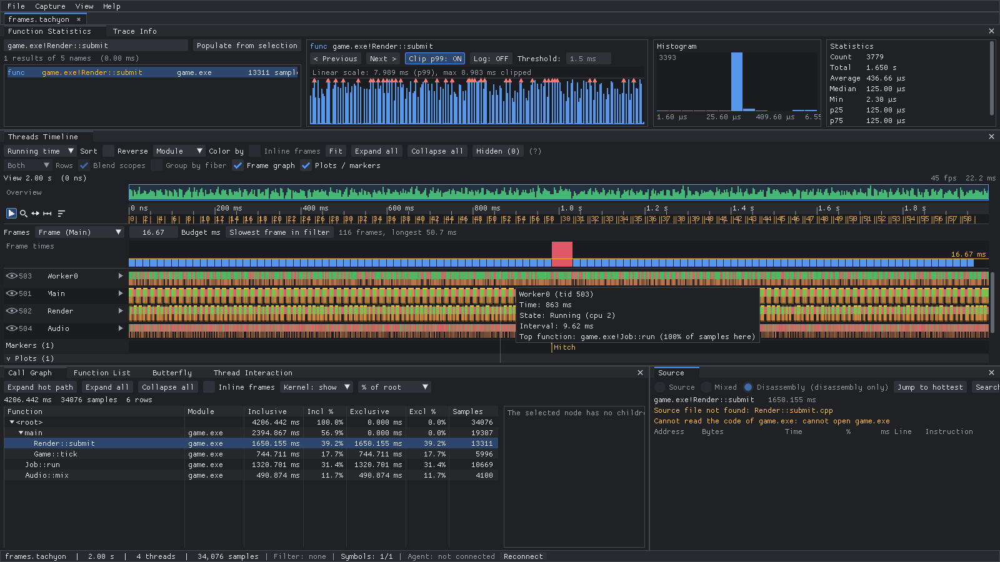

# Tachyon

Tachyon is a CPU profiler for C++ programs, built for a large game engine. It samples at 8 kHz from the kernel,
knows when each thread is running, ready or waiting (and why), can blend optional instrumentation scopes into
the sampled call stacks, and has a timeline-first viewer that stays interactive on multi-gigabyte captures.



## What it does

- **Capture** with `tachyon-agent`: 8 kHz sampling with call stacks, context switches with wait reasons, wakers
  and blocking stacks. Windows uses ETW; Linux uses `perf_event_open` (frame-pointer call stacks) plus the
  `sched` tracepoints. Launch a program, attach to a running process, or sample the whole machine; follow child
  processes.
- **Control** from `tachyon-cli` (scriptable, `--json` output, exit codes for CI) or from the viewer's Capture
  menu. A remote agent on another machine is reachable over an authenticated, unencrypted TCP channel.
- **Flight recorder:** keep the last seconds in a circular buffer and flush them when a hitch happens, from the
  CLI, the viewer or the engine (`Tachyon_RequestFlush`).
- **Live view:** watch the last 30 seconds of a running capture scroll by in the viewer, or as one text line per
  second from `tachyon-cli live`.
- **View** with `tachyon-viewer`: Threads timeline with thread-state bands, sample strips, flame charts,
  instrumentation lanes, frame graph, plots and markers; Function Statistics (per-instance duration chart,
  histogram, percentiles); Call Graph, Function List, Butterfly (callers and callees), Thread Interaction
  (who woke whom, blocking and unblocking stacks); Source and Disassembly with per-line and per-instruction time.
  See the [viewer guide](docs/viewer-guide.md).
- **Instrument** with the small C/C++ SDK in `sdk/include/tachyon/` (scopes, frame marks, markers, plots, lock
  waits, fiber switches, thread names). Overhead is a few tens of nanoseconds per scope; instrumentation is merged
  with the sampled data. See the [engine integration guide](docs/engine-integration.md).
- **Automate:** `tachyon-report` turns a trace into JSON / Markdown and fails a CI job on a regression against a
  baseline; `tachyon-cli export` writes speedscope and Chrome / Perfetto trace files.
- **Symbols:** PDB through DIA (Windows) and DWARF through libdw (Linux), found next to the module, in a local
  cache, or on a symbol server (symstore layout, debuginfod, local stores).

## Platforms and privileges

| | Windows | Linux |
|---|---|---|
| Capture backend | ETW (kernel sampling profile, context switches, ready threads) | `perf_event_open`; scheduler tracepoints when tracefs is readable, else `PERF_RECORD_SWITCH` records |
| Agent must run | elevated (administrator; needs `SeSystemProfilePrivilege`), Windows 10 1703 or newer | as root, or with `CAP_PERFMON` + `CAP_SYS_PTRACE` (`setcap`), or with `kernel.perf_event_paranoid` low enough |
| Symbols | PDB (DIA SDK from Visual Studio), local cache, symbol servers | DWARF (`libdw`), `.build-id` trees, `.gnu_debuglink`, symbol servers / debuginfod |
| Build | Visual Studio 2022, CMake 3.25+, Ninja | Clang (CI uses 18), CMake 3.25+, Ninja |
| Viewer | yes | yes (SDL2, OpenGL 3.3) |

The viewer, the CLI, the report tool, the exporters and the trace reader need no privileges. On Linux,
`tachyon-cli doctor` tells you exactly what is missing on your machine and how to fix it;
[apps/agent/LINUX.md](apps/agent/LINUX.md) explains every item. See
[apps/agent/README.md](apps/agent/README.md) for the agent in general.

Without tracefs access, Linux captures still show which thread ran on which CPU, but thread waits are drawn
grey ("waiting, reason unknown") and there are no wait reasons, blocking stacks or wakers.

## Build

Prerequisites:

- **Both:** CMake 3.25+, Ninja, a C++20 compiler, and network access on the first configure (dependencies below
  are fetched with CMake `FetchContent` and pinned by version).
- **Linux:** `clang`/`clang++`, `pkg-config`, `libdw-dev`, `libelf-dev`, `libcurl4-openssl-dev`, `libsdl2-dev`, `libgl-dev`
  (the names of the Ubuntu packages CI installs; CI also installs `clang-18`, `libclang-rt-18-dev`, `xvfb`).
- **Windows:** Visual Studio 2022 with the C++ workload and the DIA SDK (installed with it); configure from a
  "x64 Native Tools Command Prompt for VS 2022". If CMake cannot find the DIA SDK, pass
  `-DTACHYON_DIA_SDK_DIR=<path to the "DIA SDK" folder>`. SDL2 is fetched and built from source on Windows.

```sh
cmake --preset linux-release          # or windows-release, linux-debug, linux-asan, windows-debug
cmake --build --preset linux-release
ctest --preset linux-release          # unit, integration and perf-budget tests
```

Binaries land in `build/<preset>/bin/` (`tachyon-agent`, `tachyon-cli`, `tachyon-viewer`, `tachyon-report`,
`tachyon-testbed`, `tracegen`, `etlstat`, the SDK examples) and the generated sample traces in
`build/<preset>/fixtures/`. The release presets are `RelWithDebInfo`.

Useful CMake options (`-D<NAME>=ON|OFF`):

| Option | Default | Meaning |
|---|---|---|
| `TACHYON_BUILD_VIEWER` | ON | Build `tachyon-viewer` (needs SDL2 and OpenGL). Turn it off on a headless build machine. |
| `TACHYON_BUILD_TESTS` | ON (presets) | Build the tests and the sample trace fixtures. |
| `TACHYON_ENABLE_LIBDW` | ON in the Linux presets | The DWARF symbol provider. Needs `libdw`/`libelf`. |
| `TACHYON_ENABLE_DIA` | ON in the Windows presets | The PDB symbol provider. Windows only. |

`ctest --preset linux-release -LE perf` skips the timing-budget tests. Tests labelled `linux_privileged` run real
`perf_event_open` captures and skip themselves without privileges.

### Dependencies and offline builds

Fetched at configure time into `build/_deps`: fmt 10.2.1, nlohmann/json 3.11.3, zstd 1.5.6, xxHash 0.8.2,
GoogleTest 1.15.2, Zydis 4.1.0 (disassembly), Dear ImGui 1.91.5 (docking branch, pinned by commit), and SDL2
2.30.9 on Windows (Linux uses the system SDL2). To build without network access, populate the sources once and
point CMake at them:

```sh
cmake --preset linux-release -DFETCHCONTENT_FULLY_DISCONNECTED=ON \
  -DFETCHCONTENT_SOURCE_DIR_FMT=/path/to/fmt-src \
  -DFETCHCONTENT_SOURCE_DIR_NLOHMANN_JSON=/path/to/nlohmann_json-src \
  -DFETCHCONTENT_SOURCE_DIR_ZSTD=/path/to/zstd-src \
  -DFETCHCONTENT_SOURCE_DIR_XXHASH=/path/to/xxhash-src \
  -DFETCHCONTENT_SOURCE_DIR_GOOGLETEST=/path/to/googletest-src \
  -DFETCHCONTENT_SOURCE_DIR_ZYDIS=/path/to/zydis-src \
  -DFETCHCONTENT_SOURCE_DIR_IMGUI=/path/to/imgui-src
```

An earlier online configure leaves these directories under `build/_deps/<name>-src`; reuse them for a second
build tree. (On Windows add `-DFETCHCONTENT_SOURCE_DIR_SDL2=...`.) The sources are not vendored in the repository.

## Quick start

Everything below uses the bundled testbed, a program whose hot functions have known shares (`hot_a` 40%,
`hot_b` 20%, `hot_c` 10%, `spin_rest` 30%), so you can check the result. Paths are relative to the build tree
(`build/linux-release/bin/` or `build\windows-release\bin\`).

### Linux

```sh
./tachyon-cli doctor                                 # what is missing on this machine?
sudo setcap cap_perfmon,cap_sys_ptrace+ep ./tachyon-agent   # once, and after every rebuild of the agent
./tachyon-agent --backend perf &                     # listens on the default socket (see below)
./tachyon-cli capture --launch ./tachyon-testbed \
    --args "--scenario spin --duration 10" --duration 10 --out /tmp/spin.tachyon
./tachyon-viewer /tmp/spin.tachyon
```

Use an absolute `--out`: a relative name is resolved by the **agent**, in the agent's working directory, and
without `--out` the trace is named `capture-<unix time>.tachyon` there. `capture` prints `capture_done: path=...
events_lost=N` and exits 4 when events were lost. The default socket is `$TACHYON_AGENT_PIPE`, else
`/run/user/<uid>/tachyon-agent.sock`, else `/tmp/tachyon-agent.sock`. Running the agent with `sudo` instead of
`setcap` works too, but then the launched program runs as root.

The agent defaults to `--backend mock` (it copies a fixture trace instead of capturing). Always pass
`--backend perf` (Linux) or `--backend etw` (Windows) for real captures, or let the viewer start the agent for
you (below).

### Windows

In an **elevated** prompt:

```bat
tachyon-agent.exe --backend etw
tachyon-cli.exe capture --launch tachyon-testbed.exe --args "--scenario spin --duration 20" --duration 20 --out "%CD%\spin.tachyon"
tachyon-viewer.exe spin.tachyon
```

(`--out` is resolved by the agent, so give a full path.) The CLI and the viewer do not need to be elevated: the agent creates its named pipe
(`\\.\pipe\tachyon-agent`) so that the invoking, unelevated user can connect. (These Windows commands are
verified in CI on an elevated runner; the interactive run on a developer machine is still on the verification
list below.)

### From the viewer

`tachyon-viewer` can start the agent for you. Open **Capture > Start Agent** (or the Capture window): when the
viewer itself cannot capture, the button reads "Start with pkexec" on Linux (a polkit prompt) or "Start agent
(administrator)" on Windows (a UAC prompt), and "Start without elevation" starts a plain agent. Then use
**Capture > Run...**, fill in the executable and press **Start capture**; the finished trace opens
automatically. **Capture > Live...** shows the capture while it records. Details in the
[viewer guide](docs/viewer-guide.md).

### Try the viewer without capturing

The test fixtures are synthetic traces with known contents. They are generated by the build:

```sh
build/linux-release/bin/tachyon-viewer build/linux-release/fixtures/medium.tachyon   # 16 threads, 60 s, 7.5 M samples
build/linux-release/bin/tachyon-viewer build/linux-release/fixtures/frames.tachyon   # frame marks with a planted hitch
```

### Profile your own program

1. Build it with symbols and frame pointers (`-g -fno-omit-frame-pointer`, or `/Zi /Zo` on MSVC).
2. Capture it: `tachyon-cli capture --launch <exe> --args "..." --duration 30`, or `--attach <pid>`.
3. Optionally add instrumentation scopes with the SDK ([docs/engine-integration.md](docs/engine-integration.md)).
4. Open the trace in the viewer; point it at your symbols (Symbols panel, or `symbolServers` in the settings).

## Repository layout

| Path | Content |
|---|---|
| `apps/agent` | `tachyon-agent`, the capture daemon ([README](apps/agent/README.md), [Linux notes](apps/agent/LINUX.md)) |
| `apps/cli` | `tachyon-cli` ([README](apps/cli/README.md)) |
| `apps/viewer` | `tachyon-viewer` ([viewer guide](docs/viewer-guide.md)) |
| `apps/report` | `tachyon-report`, the CI report tool ([README](apps/report/README.md)) |
| `apps/testbed` | `tachyon-testbed`, a workload with known answers ([README](apps/testbed/README.md)) |
| `libs/` | trace format and I/O, model, analysis, symbols, capture backends, control protocol, instrumentation merge, report and export libraries |
| `sdk/` | the public SDK header (`sdk/include/tachyon/`), its runtime, and example "engines" |
| `tools/` | `tracegen` (synthetic trace generator) and `etlstat` (ETW spike tool) ([README](tools/README.md)) |
| `tests/` | unit, integration, perf-budget, Linux-privileged and Windows tests, and fixture inputs ([fixtures](tests/fixtures/README.md), [Windows tests](tests/windows/README.md)) |
| `cmake/`, `CMakePresets.json` | dependency pins, warning flags, presets |
| `docs/` | guides, specifications and project documents (below) |

## Documentation

User and integrator guides:

- [docs/viewer-guide.md](docs/viewer-guide.md): the viewer, panel by panel, with keys, settings and command line.
- [docs/engine-integration.md](docs/engine-integration.md): wiring the SDK into an engine; symbols in CI; hooks for
  jobs, fibers, locks, frames and hitches.
- [apps/cli/README.md](apps/cli/README.md): every `tachyon-cli` command, remote agents, live mode, `doctor`.
- [apps/agent/README.md](apps/agent/README.md) and [apps/agent/LINUX.md](apps/agent/LINUX.md): running the agent,
  privileges, the SDK transport, remote capture.
- [apps/report/README.md](apps/report/README.md): the CI report tool and its baseline thresholds.
- [apps/testbed/README.md](apps/testbed/README.md), [tools/tracegen/README.md](tools/tracegen/README.md): the
  validation workload and the synthetic trace generator (scenario schema).

Specifications and project documents (for contributors):

- [docs/specs/](docs/specs/README.md): the shared specifications: trace format, model, SDK API, control
  protocol, capture backend, symbol provider, analysis queries, attribution rules, timeline LOD, live view,
  instrumentation wire format.
- [docs/etw-notes.md](docs/etw-notes.md): ETW event layouts and findings.
- [docs/IMPLEMENTATION_PLAN.md](docs/IMPLEMENTATION_PLAN.md): the plan, decisions, work packages and gates.
- [docs/PROGRESS.md](docs/PROGRESS.md): what has merged, measured numbers, open follow-ups and the verification
  queue.
- [docs/BACKGROUND_AND_ROADMAP.md](docs/BACKGROUND_AND_ROADMAP.md): research background.

## Project status

All the work packages of the plan except one are merged: capture (Windows ETW, Linux perf), symbols (PDB, DWARF),
analysis, the viewer, the SDK, the flight recorder, remote capture, live view, the CI report tool and the
exporters. CI is green on Linux (release and ASan builds) and on a Windows runner with real ETW sessions. The
authoritative status, with every measured number, is [docs/PROGRESS.md](docs/PROGRESS.md).

What still needs a human, a real engine or real hardware (it cannot be validated in CI):

- **WP-14, capture validation on the engine: not started.** Capturing the real engine, the conversion time for
  a real engine capture and symbol resolution against the team's symbol store need the engine owner. The
  milestone gate M1 is therefore only passed for the testbed.
- **Milestone gates M4, M5, M6 are not signed off.** M4 wants 60 fps on the `large` fixture on a real GPU (the
  per-frame CPU cost is measured, a 64-row frame is still 5 to 7 ms of CPU on the build machine) and an engine
  programmer finding a planted hitch unaided. M5 wants the SDK integrated into the engine; its "under 1%
  overhead at 100 k scopes per frame" criterion cannot be met (a scope costs about 47 ns on Linux and 68 ns on
  Windows; see the plan concerns in PROGRESS.md and section 8 of the integration guide). M6 wants a 10-minute
  engine capture to load within budget.
- **Windows real-machine checks** are queued in PROGRESS.md, for example: the ETW pipeline on a dev box with the
  accuracy numbers from `etlstat` (WP-01), 20-second launch captures (WP-13), a 30-second system capture
  (WP-11), the converter on a 2 GB ETL (WP-12), the timeline at 60 fps on a mid-range GPU (WP-42), live-capture
  latency on a many-core machine (WP-65w), the viewer's UAC "start agent as administrator", the Windows process
  list and "reveal in Explorer", live OS theme switching and DPI scaling.
- **Linux scheduler tracepoints** are verified on CI's privileged step; on your own machine run
  `tachyon-cli doctor` to see which mode your kernel allows.

Known limits: the TCP channel for remote capture is not encrypted (use a trusted network or an SSH tunnel);
the instrumentation API is frozen at version 1 and has no call for GPU clock calibration.
