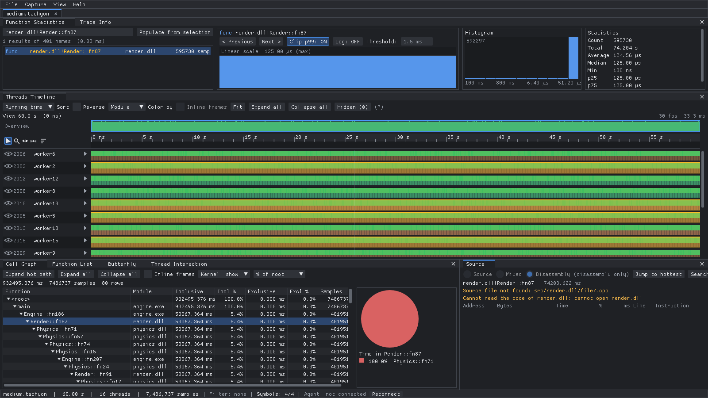
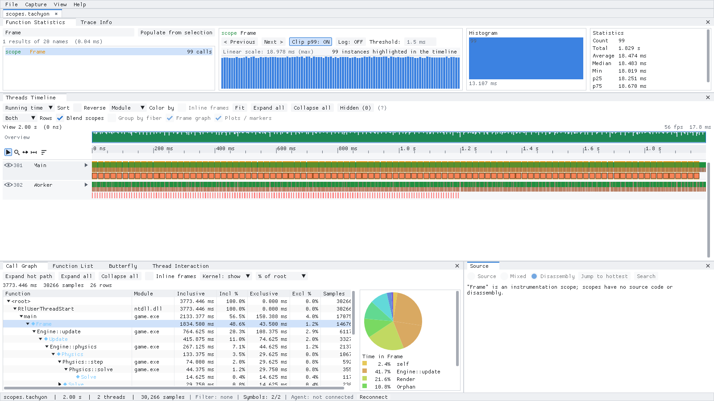
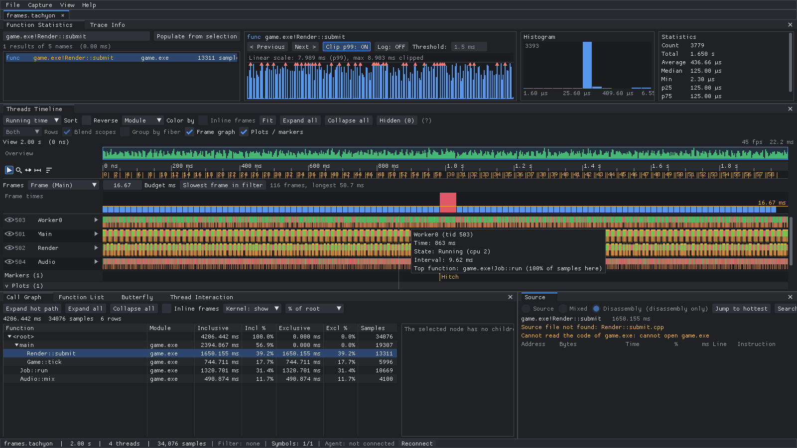

# Tachyon viewer guide

`tachyon-viewer` opens `.tachyon` traces and shows where the time went: which threads were running, ready or
waiting, which functions the samples hit, how long each instance of a function took, and which thread woke
which. It also drives captures (the agent) and shows a running capture live. It is a Dear ImGui application on
SDL2 and OpenGL 3.3 and runs on Windows and Linux.



*The default layout on a synthetic fixture (`medium.tachyon`): Function Statistics across the top, the Threads
timeline in the middle, Call Graph (with its pie) and Source along the bottom.*

Contents: [Starting](#starting-the-viewer) · [Layout](#the-default-layout) · [Themes](#themes) ·
[Timeline](#threads-timeline) · [Thread states](#thread-state-colours) · [Filtering](#selection-and-time-range-filtering) ·
[Function Statistics](#function-statistics) · [Call Graph, Function List, Butterfly](#call-graph-function-list-butterfly) ·
[Thread Interaction](#thread-interaction) · [Source](#source-and-disassembly) · [Symbols](#symbols) ·
[Capturing](#capturing-from-the-viewer) · [Live](#live-view) · [Flight recorder](#flight-recorder) ·
[Warnings](#warnings-banner-trace-info-and-the-status-bar) · [Palette](#command-palette-and-shortcuts) ·
[Settings](#settings) · [Command line](#command-line)

## Starting the viewer

```sh
tachyon-viewer                       # empty window: File > Open (Ctrl+O) or drop a .tachyon file on it
tachyon-viewer capture.tachyon       # open a trace
```

- **File > Open...** (Ctrl+O) opens a file browser (`.tachyon` files; "Show all files" lists everything), **File >
  Open Recent** lists the last 12 files, and a `.tachyon` file dropped on the window opens it. **File > Close**
  or the x on the session tab closes the trace; **File > Quit** (Ctrl+Q) exits.
- One trace is open at a time. The tab strip under the menu shows its file name ("Live capture" while a live
  view is open).
- A big trace first shows a *preview* of the first part ("preview: first N% of the trace, loading the rest" in
  the status bar) and swaps in the complete trace when it has loaded.
- Sample traces without capturing anything: build the repository and open
  `build/<preset>/fixtures/medium.tachyon` or `frames.tachyon` (see the [README](../README.md#try-the-viewer-without-capturing)).

## The default layout

On first launch (and after **View > Reset layout**) the window is docked like this:

| Area | Panels (tabs) |
|---|---|
| Top strip, about 20% of the height | **Function Statistics**, **Trace Info** |
| Middle, about 45% | **Threads Timeline** |
| Bottom left, about 65% of the width | **Call Graph**, **Function List**, **Butterfly**, **Thread Interaction** (and, when opened, Capture, Session Explorer, Live, Flight Recorder, Symbols) |
| Bottom right | **Source** (source code and disassembly) |

Panels can be dragged, tabbed, split and floated like any ImGui docking window; the arrangement is saved in
`imgui.ini` next to `settings.json` and restored on the next start. The **View** menu lists every panel (tick
to open or close it), **View > Reset layout** restores the default arrangement, and the layout is replaced once
when a new version changes the default (the `layoutVersion` setting). Capture-related panels (Capture, Session
Explorer, Live, Flight Recorder) and Symbols are closed until you open them (View menu, the Capture menu, a
capture starting, or the status bar's Symbols segment).

Other **View** entries: *Blend instrumentation scopes into sampled stacks* and *Group by fiber* (enabled only for
traces that have scopes / fiber events; every panel follows them), **Theme**, **Memory limit** and **UI Scale**
(75%, 100%, 125%, 150%, 200%, on top of the display's DPI scale).

*Memory limit* is the ceiling for the open trace's data (model, timeline index, analysis caches) as a share of
the machine's RAM: 50%, 60%, 75% (default), 90% or no limit. Above it the viewer frees optional timeline detail
levels and stops caching analysis results (a warning says so) instead of running out of memory.

## Themes

**View > Theme** offers **System** (the default), **Light** and **Dark**.

- *System* follows the operating system and re-checks every 3 seconds, so a change in the OS settings applies
  while the viewer runs. On Windows it reads `HKCU\Software\Microsoft\Windows\CurrentVersion\Themes\Personalize`
  (`AppsUseLightTheme`). On Linux it asks the desktop portal (`org.freedesktop.appearance` `color-scheme`, needs
  `gdbus`), then `gsettings get org.gnome.desktop.interface color-scheme`, then the `GTK_THEME` environment
  variable (a name containing `dark` is dark), and uses dark when none answers.
- The choice is stored as `theme` in `settings.json` (`"system"`, `"light"`, `"dark"`). A settings file written
  by an older version that said `"dark"` (then the default, not a choice) is read as System.
- The palettes, including the thread-state colours, are tuned for contrast in both themes.
- The command palette has "View: Cycle Theme (System / Light / Dark)".



*Light theme on the `scopes` fixture: the timeline rows show instrumentation scope lanes under the thread bands, and
scopes appear (blue diamonds) in the Call Graph.*

## Threads timeline

One row per thread, sorted by running time by default. Every row has two stacked graphics:

- the **state band** on top: what the thread was doing (see [thread-state colours](#thread-state-colours)),
- the **sample strip** below it: the function the samples hit, coloured by module or by function (toolbar
  *Color by*).

Click the chevron at the right end of a thread's label (or press E on the selected thread, or double-click the
label) to **expand** the row into a flame chart of the sampled call stacks over time. The eye at the left of the
label hides the thread (the **Hidden (n)** button lists hidden threads and shows them again). Right-click a row
for Expand / Collapse, Pin to top, Hide, *Row shows* (when the trace has scopes) and Select.

Above the rows: the **Overview** (a whole-trace miniature of average CPU use with a frame showing the visible
window; drag it to move the view, the filter and the selection are drawn on it), the **ruler** (time since the
start of the trace, with frame-mark ticks when the trace has them), and the thin **navigation toolbar** at the
top left of the rows.

**Toolbar:** *Sort* (Running time, Sample count, Name, Thread id, Trace order) with *Reverse*; *Color by* Module
or Function; *Fit*; *Expand all* / *Collapse all*; *Hidden (n)*; and (?) with a summary of the keys. The status
line shows the visible span and start time, "Building timeline index: n / m threads" while the index builds (the
rows fill in as threads finish), the selection and filter durations, and the viewer's frame rate on the right.
For traces with instrumentation the toolbar adds *Rows* (Sampled, Scopes, Both), *Blend scopes*, *Group by
fiber*, *Frame graph* and *Plots / markers*.

### Navigation modes

The four buttons at the top left of the rows (the sort glyph beside them opens the same sort menu) set what a
plain left-drag does:

| Mode | Left-drag | Click |
|---|---|---|
| **Pointer** (default) | pans | selects a thread / function / wait; **Shift+drag** (or a drag on the ruler) selects a time range |
| **Zoom** | selects a range and zooms into it on release | selects |
| **Pan** | pans | selects nothing on the graph |
| **Measure** | selects a range and keeps it; its length shows in the status line | selects |

### Keys and mouse

| Input | Effect |
|---|---|
| Mouse wheel | zoom around the cursor |
| Shift + wheel, or horizontal wheel | scroll horizontally (10% of the view per notch) |
| Ctrl + wheel | scroll the thread rows vertically |
| Middle-button drag | pan (in any mode) |
| Left drag | per navigation mode above; a drag on the ruler or the overview always acts on the time axis |
| `A` / Left, `D` / Right | pan left / right by 10% of the view (Shift: 5 times faster) |
| `W` / `+` / `=`, `S` / `-` | zoom in / out around the cursor (the centre when the cursor is elsewhere) |
| `Home` | fit the whole trace |
| `Z` | zoom to the selection (or to the filter when there is no selection) |
| `F` | use the selection as the time filter |
| `Esc` | clear the selection (and the filter the timeline applied); also clears a selected wait |
| Up / Down | select the previous / next thread |
| PageUp / PageDown | scroll the rows by a page |
| `E`, `P` | expand / collapse, pin / unpin the selected thread |
| Double-click a thread label | expand / collapse the row |
| Ctrl held while hovering a wait | adds the Thread Interaction summary to the tooltip |
| Click a frame-graph bar | jump to that frame |

Keys act when the timeline is hovered or focused and no text field is active; combinations with Ctrl or Alt
belong to the application.

Hover tooltips show the thread (and tid), the time since the trace start, the state at the cursor (running on
which cpu, ready, or waiting with the wait reason and its category), the length of that state interval, and
either the top function in the pixel column with its share or, in an expanded row, the stack span under the
cursor. A click on a sampled function selects it everywhere (Call Graph, Function List, Butterfly, Source and
Function Statistics follow). A click on a *Waiting* or *Ready* interval selects that wait and opens Thread
Interaction (it shows wake-up arrows too).

### Instrumentation lanes, frame graph, plots and markers

For traces captured with the SDK the timeline can also show:

- **Scope lanes** under a thread's band (*Rows*: Sampled, Scopes or Both; per row from the right-click menu).
  Click a scope to select it as a function.
- The **frame graph**: one bar per frame of a frame-mark series (`TACHYON_FRAME`), the frame budget as a line
  (default 16.67 ms, the `frameBudgetMs` setting; the *Budget ms* field overrides it per series), bars over the
  budget in red, a series chooser (for example `Main` and `Render`), and **Slowest frame in filter**, which jumps
  to the longest frame in the current time filter.
- **Markers** (instant events, such as a hitch marker) and **plots** (numeric series, such as frame time) in a
  group below the rows; the Plots header collapses it.
- Fibers: with *Group by fiber* scopes are paired and blended per fiber.



*The `frames` fixture: the frame graph shows one tall red bar (the planted hitch), the "Hitch" marker lies below the
rows, and the tooltip describes the sampled state under the cursor.*

## Thread-state colours

The state band shows what each thread was doing. The scheduler data (Windows context switches, Linux scheduler
records) gives the intervals; a pixel column covering several states is mixed in proportion.

| Colour (dark theme) | State | Meaning |
|---|---|---|
| Green | **Running** | on a cpu (the tooltip says which) |
| Amber | **Ready** (preempted) | runnable and waiting for a cpu: preempted, or woken and not yet scheduled |
| Pink-red | **Waiting: synchronization** | blocked on a lock, event, condition variable, queue or similar. Linux: interruptible sleep (`S`). Windows: Executive, UserRequest, event pair, queue, mutex, push lock, resource, ... |
| Dark blue | **Waiting: I/O** | Linux: uninterruptible sleep (`D`, usually disk or a driver). Windows: LPC receive / reply |
| Light blue | **Waiting: memory** | Windows only: page-in, page-out, pool allocation, virtual memory |
| Grey | **Waiting: other** | timed sleep or delay, suspended, stopped, a reason that maps to no category, and **reason unknown** (see below) |
| Near-background (very dark in the dark theme, pale in the light theme) | **Unknown** | no scheduler information: before a thread's first record, or in a trace without context switches |

**Grey "waiting, reason unknown" on Linux.** Without access to tracefs (see
[apps/agent/LINUX.md](../apps/agent/LINUX.md)) the agent records context switches from `PERF_RECORD_SWITCH`
records. These say when a thread stopped and started running, but not why, so every wait has reason 0 and the
tooltip reads "Waiting - Unknown (no sched tracepoint) (Other)". There are then no blocking stacks and no wakers
either. `tachyon-cli doctor` reports which mode your machine uses, and the capture's warnings say so too.

Preempted threads are drawn amber, not as a wait (a thread that is runnable is Ready by definition).

## Selection and time-range filtering

Everything below the timeline answers for the current **filter**: a time range, optionally narrowed to one
call-graph subtree. The status bar shows it as "Filter: none" or, for example, "Filter: time 1.200-1.800 s,
subtree Engine::update".

1. **Time range.** Drag a range (Shift+drag, the Zoom or Measure modes, or a drag on the ruler), then press `F`
   to make it the time filter. The overview shows the filter as a tinted band and the timeline's status line says
   "Filter: 600 ms". `Esc` removes the range the timeline applied (a subtree restriction set from the Call Graph
   stays).
2. **Subtree.** In the Call Graph, **Filter to subtree** restricts the Function List and Butterfly (through their
   "Call graph subtree" tick boxes) to one call path; the "x" next to the subtree label in the Call Graph clears
   it.

Selecting a *thread* (click a label or a row, Up / Down, or a row in Trace Info) is a selection, not a filter: it
drives the E / P keys and the Source and Interaction panels' context, but the analysis panels still cover all
threads. (A thread restriction exists in the filter model, and shows in the status bar when set, but nothing in
the viewer sets one yet.)

Selecting a function anywhere (timeline, Call Graph, Function List, Butterfly, Thread Interaction stacks,
Function Statistics) selects it in every panel: Source shows it and Function Statistics can take it with
**Populate from selection**.

## Function Statistics

The top strip answers "how long does each call of this function take, and when were the slow ones?". It is laid out
left to right (stacked vertically when the panel is narrow):

- **Search** (Ctrl+F focuses it from anywhere; "Search functions and scopes (fuzzy)"). Type part of a name; the
  list shows matches (kind `func` or `scope`, name, module, sample or call count). Up / Down (PageUp / PageDown
  by 10) move the cursor, Enter chooses. **Populate from selection** takes the function selected elsewhere.
- **Instance chart.** One bar per instance of the chosen function or scope, in time order across the current
  filter range. For a scope an instance is one call (begin to end); for a sampled function it is a run of
  consecutive samples (an approximation, the panel says so). Hover a bar for its duration, click it to navigate
  the timeline to the longest instance in that column. The same instances are highlighted in the timeline.
  - **< Previous / Next >** step through the instances (F3 / Shift+F3 from anywhere while the panel is open); the
    caption names the thread, start time and duration of the current one.
  - **Clip p99: ON** (default): bars are scaled to the 99th percentile of the shown instances; longer bars are
    drawn clipped with a red cap, so one extreme outlier does not flatten the rest.
  - **Log: ON/OFF** (default off): logarithmic bar height, anchored at the shortest shown instance; falls back to
    linear when all instances have the same duration.
  - **Threshold:** type a duration (`1.5 ms`, `143 ms`, `300 us`) to draw a line at it; instances above it are
    highlighted and counted ("N above threshold"). Drag the line to change it; empty or 0 turns it off; **Clear**
    removes it.
- **Histogram** of the instance durations (logarithmic buckets; hover a bucket for its range and count).
- **Statistics**: Count, Total, Average, Median, Min, p25, p75, Max, a box plot; for scopes, unterminated scopes
  (ended at the trace end) and orphan End events are noted.

The chart's Clip, Log and Threshold values are per user, not per trace (`statsClipOutliers`, `statsLogScale`,
`statsThresholdUs` in the settings).

## Call Graph, Function List, Butterfly

All three follow the filter and share these options: **Inline frames** (expand inlined functions; needs symbols
with inline information), **Kernel: show / group / hide** (kernel frames), and, for scopes, the global *Blend
instrumentation scopes* option. Function names are shown with the module in its own column.

- **Call Graph**: the top-down call tree. Columns: Function, Module, Inclusive (ms), Incl %, Exclusive (ms),
  Excl %, Samples. *% of root* / *% of parent* switches the percentage base. Buttons: **Expand hot path**
  (follow the heaviest child), **Expand all**, **Collapse all**. Right-click a row: **Filter to subtree**, Show in
  Function List, Show source, Copy name, Expand hot path from here. Double-click shows the source. The **pie**
  (to the right of the table, or below when narrow) splits the selected node's time between the function itself
  and its callees. Scopes appear as blue diamonds when instrumentation is blended in.
- **Function List**: every function, sortable (Inclusive, Exclusive, Instances), with a filter box ("function or
  module"), **Group by module** (a module row sums its functions; per-module inclusive time counts a sample once
  per function of that module on its stack and can exceed real time, the tooltip says so, exclusive is exact)
  and **Call graph subtree**. Right-click: Show in Call Graph, Show source, Copy name; double-click shows source.
- **Butterfly**: for the selected function, its **callers** above and **callees** below, with inclusive and
  exclusive time; click a row to select that function.

## Thread Interaction

Select a wait by clicking a Waiting or Ready interval in the timeline (or a row in the list). The panel shows
the thread, **Woken by** (the waker thread), the wait reason and category, the wait duration, the **ready
latency** (from being woken to getting a cpu) and when it switched out, with **Go to waker** / **Go to woken**
buttons that move the timeline there, plus two stacks: the **blocking stack** (why it stopped) and the
**unblocking stack** (who woke it). The lower table lists the **longest waits in the filter range** (set N); click a
row to inspect it. Wake-up arrows are drawn in the timeline. Blocking stacks and wakers need the scheduler
tracepoints on Linux (or ETW ready-thread events on Windows); without them the panel has only the durations.

## Source and disassembly

The Source panel (bottom right) shows the function selected in the Call Graph, Function List, Butterfly or
timeline, with the time samples spent on every line and instruction in the current filter:

- **Source**: the file, with a time bar per line, running / ready / waiting split, a heat background and ms / %
  columns (hover a line for the numbers).
- **Mixed**: source with an expander (`>`) per line that lists the instructions mapped to it with their own times.
- **Disassembly**: the function's instructions (Zydis, x86-64). It is the only mode when the source file cannot be
  found. Samples of a *caller* frame sit on the instruction after the call and carry an "after call" tag.
- **Jump to hottest**, **Search** (Ctrl+F while the panel is focused; Enter / Shift+Enter or F3 / Shift+F3 move
  between matches, Esc closes), **Expand all / Collapse all** (Mixed), **Reload**.
- **Locate file...** appears when the debug-info path does not exist on this machine. Pick the file (or
  directory); the viewer derives a path-prefix mapping from it, stores it (`sourcePathMappings` / `sourceRoots`)
  and uses it from then on.
- Disassembly needs the program's binary itself at the recorded path ("Cannot read the code of x: cannot open x"
  otherwise). Scopes have no source. Time without line information is reported separately.

## Symbols

Names come from symbol files matched to each module by identity (PDB GUID and age, or GNU build-id; PE timestamp
and size as a fallback), so the trace works wherever it is opened. Without symbols, frames show as `module+0xRVA`.

Lookup order for a module: your explicit **symbol search paths** first, then next to the module, then the local
**cache**, then the configured **symbol servers** in order (HTTP symbol servers in the symstore layout,
debuginfod for build-ids, or local symbol-store directories). On Linux `.build-id/xx/rest.debug` trees (including
`/usr/lib/debug`) and `.gnu_debuglink` files next to the image are found too. Nothing touches the network
unless you configure a server; there is **no default symbol server**.

- The status bar shows **Symbols: resolved/total** (amber when some failed). Click it to open the **Symbols**
  panel: one row per module with state (Pending, Loading, Resolved, NotFound, Failed), the reason, **Retry**
  and **Copy module info** per row, **Retry all**, **Add symbol path...** and the list of search paths.
  Hovering the status segment lists the modules.
- **Symbols: Add Symbol Path...** (command palette, or the Symbols panel) adds a directory (searched for symbol
  files and `*.symbols.json`) or a file and re-runs resolution. The list is saved as `symbolSearchPaths`.
- Symbol servers and the cache directory are set in `settings.json`: `symbolServers` (a list of URLs or local
  store directories; nothing by default), `cacheDir` (default `%LOCALAPPDATA%\Tachyon\symbols` on Windows,
  `$XDG_CACHE_HOME/tachyon/symbols` or `~/.cache/tachyon/symbols` on Linux). For example, to resolve Windows
  system DLLs add `"https://msdl.microsoft.com/download/symbols"`. The viewer does not read `DEBUGINFOD_URLS`;
  list a debuginfod server in `symbolServers` instead.
- A trace from another machine resolves as long as the debug files are reachable by identity; for a remote
  trace, `.gnu_debuglink` names cannot be followed (the link lives in the image).

## Capturing from the viewer

The **Capture** menu: *Run...*, *Attach...*, *System capture...*, *Live...*, *Resume* / *Stop* / *Cancel*,
*Capture Window*, *Flight Recorder Window*, *Reconnect to Agent*, *Start Agent*, *Connect to Remote Agent...*,
*Use Local Agent*. The **Capture** panel shows the agent connection, the state of the capture and the buttons;
the status bar shows the agent segment (click it for the Capture window) with Stop / Resume / Reconnect.

**The agent.** Captures are done by `tachyon-agent`; the viewer connects to the default socket / pipe
(`agentAddress` overrides it) when it starts (`autoConnect`) and can start one for you: *Start Agent* runs the
`tachyon-agent` next to the viewer binary (`agentExe`) with the platform's backend (`agentBackend`: `etw` on
Windows, `perf` on Linux, or `mock`) and any `agentArgs`. When the viewer itself lacks the privileges the backend
needs, the Capture window offers **Start with pkexec** (Linux) or **Start agent (administrator)** (Windows UAC),
and **Start without elevation**. A pkexec agent hands its socket to the invoking user, so the unprivileged viewer
can connect.

**Dialogs.** All three capture dialogs share the fields below; a *Remote agent* note appears when connected to
one (paths and processes are then on the agent's machine).

| Field | Meaning |
|---|---|
| Mode: Run application / Attach to process / System | launch a program, sample a running process (pick it from the process list: filter by pid, name, user, command; Refresh), or sample the whole machine (the agent needs administrator / root) |
| Executable, Arguments, Working directory, Environment | for Run: arguments are split like a shell (`--scene "My Level"`); `KEY=VALUE` variables |
| Start immediately | off = the program is launched parked and recording starts when you press **Resume** (use it to attach other tools first) |
| Sampling rate (Hz) | default 8000 |
| Circular buffer (MB, 0 = off) | > 0 makes a [flight recorder](#flight-recorder) capture |
| Follow children, Child filter | also profile child processes (optionally only those matching a glob, for example `*.exe`) |
| Kernel stacks | include kernel frames |
| Output file | empty = `<captures dir>/<name>-<date>.tachyon`; for a remote agent only a file name |

*Start capture* runs; when you press Stop (or the target exits) the agent converts the capture ("Converting"
progress), and the trace opens automatically (`autoOpen`). Captures go to the captures directory (default
`%LOCALAPPDATA%\Tachyon\captures` or `$XDG_DATA_HOME/tachyon/captures`, set `capturesDir`). The **Session
Explorer** panel (View menu, or "Capture: Show Session Explorer" in the palette) lists the traces there with name, time,
size, mode, target, sampling rate, duration, events lost and agent, with filter, sorting, **Open**, **Reveal**
and **Delete** (**Forget** for entries whose file is gone).

**Remote agent.** *Connect to Remote Agent...* takes `host:port` and the path of the token file (only the path is
saved) and has a **Test connection** button. Finished traces are copied to the local captures directory over the
connection (progress, Cancel and Retry in the Capture window). The channel is not encrypted: use a trusted
network or an SSH tunnel (see [apps/agent/README.md](../apps/agent/README.md)). Launching programs on a remote
agent works only when that agent was started with `--allow-remote-launch`.

## Live view

**Capture > Live...** opens the same dialog in live mode. While the capture records, the viewer shows the **last
30 seconds** as a normal document (title "Live capture"), swapped at most every 500 ms, with every panel working
on it. The Live panel and the toolbar show:

- **Follow** (timeline toolbar and the Live panel): keep the newest window in view; panning or zooming turns it
  off, pressing it again turns it back on.
- **Pause / Resume**: freeze the displayed window while the capture continues.
- **Save last 30 s**: write the window to a trace (needs a circular capture: set *Circular buffer* in the dialog).
- **Stop**: stop the capture and open the final trace (the live view is replaced by it).
- Statistics: window length, thread and sample counts, latency (not shown for a remote agent), events the live path
  dropped (the final trace is unaffected), gaps and resyncs.

The status bar shows `LIVE  12.0 s  latency 0.43 s  dropped 0  gaps 0` (`LIVE STOPPED` on an error, `ENDED`
after the capture finished). A live window is partial by nature, so it has no warnings banner.

## Flight recorder

Start a capture with **Circular buffer (MB) > 0**: the agent records continuously, keeping only the newest data.
The **Flight Recorder** panel (opens when such a capture starts) shows *ARMED* with the target and ring size,
a **seconds** field with **Flush now** (also *Capture: Flush Flight Recorder Now* in the palette), and the list
of flushed traces (name, duration, how many triggers were coalesced) with **Open**. A flush also happens when the
instrumented program calls `Tachyon_RequestFlush("reason")` (see
[engine-integration.md](engine-integration.md#59-hitch-trigger-and-flight-recorder)); those files appear in the same list.
When the viewer did not start the capture it cannot tell whether it is circular ("Capturing (started elsewhere)").

## Warnings banner, Trace Info and the status bar

- **Warnings banner** (amber, below the menu, only for finished traces): what the trace says about its own data
  quality: events lost (including ETW buffers lost), the kernel throttling sampling, dropped instrumentation
  records and the merge's own warnings, converter warnings (for example, "scheduler tracepoints unavailable, wait
  reasons are not recorded"), a partial (unfinalized or torn) trace, the memory limit having freed data, and
  warnings the agent reported when the capture ended (spool caps reached, refused SDK connections, failed
  merges). It shows up to four lines (hover "... and N more" for the rest). **Dismiss** hides it for that trace;
  it comes back if a new warning appears.
- **Trace Info** (tab next to Function Statistics): file name, "Partial trace" flag, duration, thread, module and
  sample counts, callstack nodes and resident memory, the number of unattributed switch records (a small residue
  from exiting tasks is normal and only listed here), and the thread table (name, tid, role, samples); click a
  row to select the thread.
- **Status bar**: trace name, duration, threads, samples, `Filter: ...`, `Symbols: n/m`, the agent connection
  and capture state, the live segment, and, on the right, background jobs (timeline index, symbol resolution,
  transfers) with a progress bar and **Cancel**. Errors appear in red; transient messages are toasts.

## Command palette and shortcuts

**Ctrl+P** (or Help > Command Palette) opens a palette: type to filter commands by a case-insensitive subsequence
of their title, Up / Down choose, Enter runs, Esc closes. It lists every command (File, View, Capture, Live,
Symbols, Help) plus "View: Toggle <panel> Panel" for each panel. **`?`** (or Help > Keyboard Shortcuts) lists the
shortcuts, which is the authoritative, current list.

| Key | Action |
|---|---|
| Ctrl+O / Ctrl+Q | open a trace / quit |
| Ctrl+P | command palette |
| Ctrl+F | search in Function Statistics (in Source: search the file, when Source is focused) |
| `?` | keyboard shortcut list |
| Timeline, Function Statistics, Source | see the sections above |

## Settings

`settings.json` lives in `%APPDATA%\Tachyon\` on Windows and `$XDG_CONFIG_HOME/tachyon/` (default
`~/.config/tachyon/`) on Linux, next to `imgui.ini` (the window layout). `--config PATH` uses another file
(and keeps `imgui.ini` beside it). The viewer rewrites it as you change things; a missing or corrupt file gives
defaults (a corrupt one logs a warning). Unknown keys are dropped on the next save.

| Key | Default | Meaning |
|---|---|---|
| `symbolServers` | `[]` | symbol server URLs or local symbol-store directories, consulted in order |
| `symbolSearchPaths` | `[]` | directories / files searched first (the Symbols panel edits this) |
| `cacheDir` | `""` | symbol cache directory (empty: the default under the user cache dir) |
| `sourcePathMappings` | `[]` | `{"from": "...", "to": "..."}` prefix rules for debug-info source paths |
| `sourceRoots` | `[]` | directories searched by the trailing components of a source path |
| `theme` | `"system"` | `"system"`, `"light"` or `"dark"` |
| `settingsVersion` | `2` | internal: marks the System-theme era (an older `"dark"` becomes System) |
| `layoutVersion` | current | internal: a lower value replaces the saved layout with the new default once |
| `uiScale` | `1.0` | 0.5 to 4, times the display DPI scale |
| `recentFiles` | `[]` | up to 12, most recent first |
| `blendScopes` | `true` | blend instrumentation scopes into sampled stacks |
| `frameBudgetMs` | `16.67` | default frame budget of the frame graph (0.1 to 10000) |
| `memoryCeilingPercent` | `75` | data ceiling as a percentage of RAM (10 to 100, or 0 for none) |
| `statsClipOutliers` | `true` | Function Statistics "Clip p99" |
| `statsLogScale` | `false` | Function Statistics "Log" |
| `statsThresholdUs` | `0` | Function Statistics threshold in microseconds (0 = none) |
| `capture` | object | see below |

`capture` keys: `capturesDir` (default under the user data dir), `agentAddress` (socket path / pipe name; empty =
default), `agentExe` (empty = `tachyon-agent` beside the viewer), `agentBackend` (`"mock"`, `"perf"`, `"etw"`;
empty = the platform's real backend), `agentArgs` (extra arguments for an agent the viewer starts, for example
`["--mock-fixture", "x.tachyon"]`), `remoteAddress`, `remoteTokenFile` (path only), `autoConnect`
(`true`), `autoOpen` (`true`), and the last-used values of the capture dialogs: `exe`, `args`, `cwd`, `env`,
`startImmediately` (`true`), `samplingHz` (`8000`), `circularMb` (`0`), `followChildren`, `childFilter`,
`kernelStacks` (`true`).

Environment: `TACHYON_WINDOW_SIZE=<w>x<h>` sets the initial window size (default 1600x900; a developer hook used
for the screenshots), `TACHYON_AGENT_PIPE` is the default agent address.

## Command line

```
tachyon-viewer [options] [trace.tachyon]
  --config <path>     settings file to use (default: the user config dir)
  --selftest <trace>  headless: open the trace, run 100 frames, exit 0 on success
  --bench <trace>     headless frame-time benchmark: open the trace, then measure steady,
                      panning and zooming frames (CPU ms) with the timeline and panels open
  --bench-frames <n>  frames per --bench phase (default 300; 10 to 100000)
  --demo-select       (for screenshots) select the hottest call-graph function once it is ready
  -h, --help          show this help
```

At most one trace may be given. Exit codes: 0 normal; 2 for a command-line error (the usage text is printed);
1 when the window or a headless run fails to start or the trace cannot be loaded in `--selftest`. `--selftest`
and `--bench` need no display and never touch your settings.
